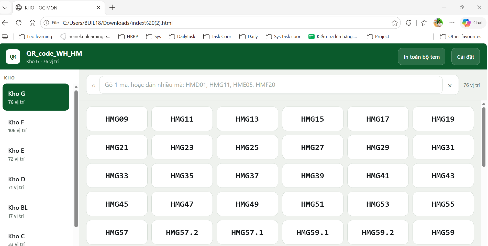

# QR_code_WH_HM — Tra cứu & in tem QR vị trí kho

Web app **một file, chạy offline** giúp tra cứu và in tem QR cho từng vị trí pallet
tại kho thành phẩm Hóc Môn.

Trước đây muốn in bộ tem cho cả kho phải tách thủ công hơn 300 ảnh QR từ một file PDF
(kích thước không đồng nhất), rồi dán vào Word để chỉnh và in — mất khoảng **1,5 ngày công**.
Với app này, toàn bộ việc đó còn **5 phút**.



## Tính năng

- **Chọn kho → chọn vị trí** trên lưới cảm ứng, phù hợp dùng trên máy tính bảng.
- **Tra nhiều mã cùng lúc**: gõ hoặc dán `HMD01, HMG11, HME05` — kết quả giữ đúng thứ tự đã nhập, tìm xuyên tất cả các kho.
- **Phóng to để quét** ngay trên màn hình, kèm công cụ thử 4 cỡ mã để tìm cỡ máy quét đọc tốt nhất.
- **In tem hàng loạt**: in 1 tem, in theo danh sách đang hiển thị, in cả kho, hoặc in toàn bộ các kho; chọn 2/4/6/9 tem mỗi trang A4.
- **Tự quản lý danh sách vị trí**: thêm/sửa/xoá kho, tạo nhanh dải mã bằng mẫu `HME{01-90}`.
- **Khoá cài đặt bằng mã PIN** để nhân viên đứng máy không sửa nhầm danh sách.
- **Không phụ thuộc gì bên ngoài**: QR được sinh ngay trong trình duyệt, không cần mạng, không thư viện, không server.

## Dữ liệu hiện có

| Kho | Số vị trí |
|---|---|
| Kho G | 76 |
| Kho F | 106 |
| Kho E | 72 |
| Kho D | 71 |
| Kho BL | 17 |
| Kho C | 33 |
| Kho Lẻ | 1 |
| **Tổng** | **376** |

Nội dung mã QR mặc định là `{"V":"<mã vị trí>"}`, đúng định dạng tem đang dán trên kệ.

## Dùng nhanh

Tải file `index.html` về rồi mở bằng Chrome hoặc Edge — chạy được ngay, không cần cài gì.

Muốn nhiều máy dùng chung một link: xem [docs/trien-khai.md](docs/trien-khai.md).

## Cấu trúc dự án

```
index.html                  App — toàn bộ giao diện, mã sinh QR và dữ liệu nằm trong file này
data/vi-tri-kho.json        Danh sách kho & vị trí (bản tách riêng để dễ xem lịch sử thay đổi)
tools/sync-seed.mjs         Ghi data/vi-tri-kho.json ngược vào index.html
docs/huong-dan-su-dung.md   Hướng dẫn cho người vận hành
docs/trien-khai.md          Cách đưa lên GitHub Pages / Netlify
docs/ky-thuat.md            Ghi chú kỹ thuật cho người bảo trì
```

## Cập nhật danh sách vị trí

Có hai cách, chọn cách nào cũng được:

**Cách 1 — sửa trong app** (không cần biết code): mở *Cài đặt → Kho & vị trí*, sửa xong
sang tab *Sao lưu* bấm **Tạo file để đăng lại lên web**, rồi thay file `index.html` trong repo
bằng file vừa tải về. Nhớ chạy `node tools/sync-seed.mjs --extract` để cập nhật luôn file JSON.

**Cách 2 — sửa file JSON** (hợp khi làm việc qua Git):

```bash
# sửa data/vi-tri-kho.json, tăng "version" lên 1
node tools/sync-seed.mjs        # ghi dữ liệu mới vào index.html
```

Tăng `version` là bắt buộc — máy nào đã mở app trước đó chỉ nhận danh sách mới khi số này lớn hơn.

## Lưu ý

- Mã PIN trong *Cài đặt → Khoá* chỉ để **chống sửa nhầm**, không phải bảo mật: nó nằm ngay trong file nên người rành kỹ thuật vẫn vượt được. Đừng dùng lại PIN của hệ thống khác.
- Mỗi máy lưu cài đặt riêng trong trình duyệt (`localStorage`). Muốn đồng bộ, dùng *Sao lưu → Xuất/Nhập file .json*.

## Giấy phép

[MIT](LICENSE)
